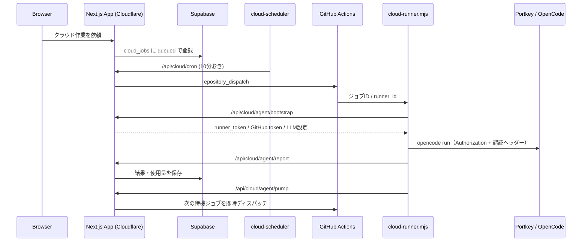

# LLM接続設計（Portkey / OpenCode）

アプリ本体とクラウド作業ランナーが、Portkey経由またはOpenCodeへ直接接続するときの設計をまとめる。

## 1. 全体像



## 2. 認証は2層

### Portkeyゲートウェイ認証

- ヘッダー: `x-portkey-api-key`
- 値: `PORTKEY_API_KEY`、未設定なら `OPENAI_API_KEY`
- 実装: `src/lib/ai/models.ts` の `getLlmAuthHeaders()`

### 上流プロバイダー認証

- OpenCodeへ直接接続する場合: `Authorization: Bearer <OPENCODE_API_KEY>`
- Portkey経由の場合:
  - PortkeyのModel Catalog / Config / Virtual Keyに上流キーを保存する
  - または `Authorization: Bearer <上流プロバイダーキー>` を送る
- OpenCode Go（Goレーン）は `x-opencode-session` が必須
  - 実装: `isOpenCodeBackend()` が真なら `x-opencode-session` を自動付与

## 3. バックエンド判定

`src/lib/ai/models.ts`

- `isPortkeyBackend()`
  - `OPENAI_BASE_URL` のホストに `portkey` を含む、または `OPENAI_BACKEND=portkey`
- `isOpenCodeBackend()`
  - `OPENAI_BACKEND=opencode` が最優先
  - 未指定時はモデルID / ベースURLに `opencode` を含むかで判定
- 両方成立し得る（Portkey経由でOpenCodeへ転送する構成）
  - `x-portkey-api-key` と `x-opencode-session` の両方を送る

## 4. 環境変数パターン

### A. OpenAI互換APIへ直接接続

```env
OPENAI_API_KEY=sk-...
OPENAI_BASE_URL=https://api.openai.com/v1
OPENAI_MODEL_SOLVING=gpt-4o-mini
```

### B. OpenCodeへ直接接続

```env
OPENAI_API_KEY=<OpenCode APIキー>
OPENAI_BASE_URL=https://opencode.ai/zen/go/v1
OPENAI_BACKEND=opencode
OPENAI_MODEL_SOLVING=deepseek-v4.1-flash
```

### C. Portkey経由（上流キーをPortkey側に保存）: 現在の構成

```env
OPENAI_API_KEY=<Portkey APIキー>
OPENAI_BASE_URL=https://aigw.portkey.ai/v1
OPENAI_BACKEND=opencode
OPENAI_MODEL_SOLVING=deepseek-v4.1-flash
# PORTKEY_API_KEY は不要（未設定なら OPENAI_API_KEY を x-portkey-api-key に使う）
# PORTKEY_PROVIDER は Portkey 側のデフォルト設定でルーティングするなら不要
```

Portkeyへ送られるヘッダー:

- `x-portkey-api-key`: `OPENAI_API_KEY`
- `Authorization`: `OPENAI_API_KEY`（Portkey側で上流キーを保存している場合は使われない）
- `x-opencode-session`: 自動付与

### D. Portkey経由（プロバイダーキーをリクエストで渡す）

```env
OPENAI_API_KEY=<上流プロバイダーキー>
PORTKEY_API_KEY=<Portkey APIキー>
OPENAI_BASE_URL=https://aigw.portkey.ai/v1
OPENAI_BACKEND=opencode
OPENAI_MODEL_SOLVING=deepseek-v4.1-flash
PORTKEY_PROVIDER=@opencode-go
```

- `x-portkey-api-key`: `PORTKEY_API_KEY`
- `Authorization`: `OPENAI_API_KEY`
- `x-portkey-provider`: `PORTKEY_PROVIDER`

### E. Virtual Key / Configを使う

```env
PORTKEY_VIRTUAL_KEY=pk-...
# または
PORTKEY_CONFIG=pc-...
```

`PORTKEY_VIRTUAL_KEY` と `PORTKEY_CONFIG` は任意。設定時は `x-portkey-virtual-key` / `x-portkey-config` として送られる。

## 5. クラウド作業の流れ

1. `POST /api/cloud/jobs` で `cloud_jobs` に登録
2. `workers/cloud-scheduler` が10分おきに `/api/cloud/cron` を呼ぶ
3. `runCloudTick()` が古いジョブの掃除・Issue取り込み・待機ジョブ起動を行う
4. `dispatchActionsJob()` がGitHub Actionsを起動
5. ランナーは `/api/cloud/agent/bootstrap` で以下を受け取る
   - `runner_token`
   - GitHubトークン
   - `llm.base_url` / `llm.api_key` / `llm.model`
   - `llm.opencode` / `llm.headers`
6. `scripts/cloud-runner.mjs` がopencode設定を書き、LLMを呼ぶ
7. 完了時に `/api/cloud/agent/report` へ結果を送る
8. レポート後に `/api/cloud/agent/pump` を呼び、待機中の次ジョブを即時起動

### 実行枠と待機

- `CLOUD_MAX_CONCURRENT` で同時実行数を制限
- 枠が空いていない場合、承認・再実行は `queued` になる
- 実行中ジョブが終了すると `pump` が次ジョブを開始する
- 待機中ジョブには「実行」ボタンを表示しない（自動で開始される）

## 6. エラーと意味

| エラー | 意味 | 確認箇所 |
|---|---|---|
| `Portkey Error: Invalid API Key. Error Code: 03` | Portkeyゲートウェイ認証に失敗 | `x-portkey-api-key` の値 |
| `Request is missing x-opencode-session` | OpenCode GoへセッションIDが届いていない | `OPENAI_BACKEND=opencode`、`x-opencode-session` の転送 |
| `Upstream request failed: Invalid credential` | Portkeyから先の上流プロバイダー認証に失敗 | Portkey側の上流キー、または `Authorization` の値 |
| `モデル ... が見つかりません` | モデルIDがバックエンドに存在しない | `OPENAI_MODEL_SOLVING` / Portkeyのモデル設定 |

## 7. 実装ファイル

- `src/lib/ai/models.ts`
  - ベースURL・モデル解決
  - Portkey / OpenCode判定
  - `x-portkey-api-key` / `x-opencode-session` の生成
- `src/lib/ai/call.ts`
  - アプリ本体からのLLM呼び出し
- `src/app/api/cloud/agent/bootstrap/route.ts`
  - ランナーへLLM設定を渡す
- `scripts/cloud-runner.mjs`
  - opencodeの実行設定を組み立てる
- `src/lib/cloud/jobs.ts`
  - クラウドジョブの起動・再実行・ポンプ
- `.env.local.example`
  - 環境変数のサンプル

## 8. セキュリティ

- LLMキーはランナーへbootstrap API経由で渡し、リポジトリに保存しない
- ランナーのログ・ジョブ結果には秘密情報を出さない
- クラウド作業のプロンプトには信頼できないIssue本文が含まれるため、命令として扱わない
- 保護対象ファイル・秘密情報・危険な指示は実行前に検査する
